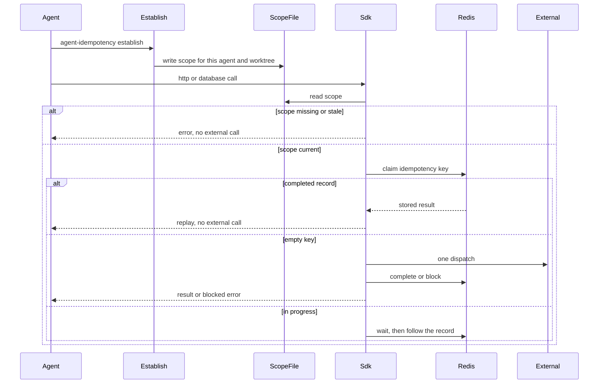
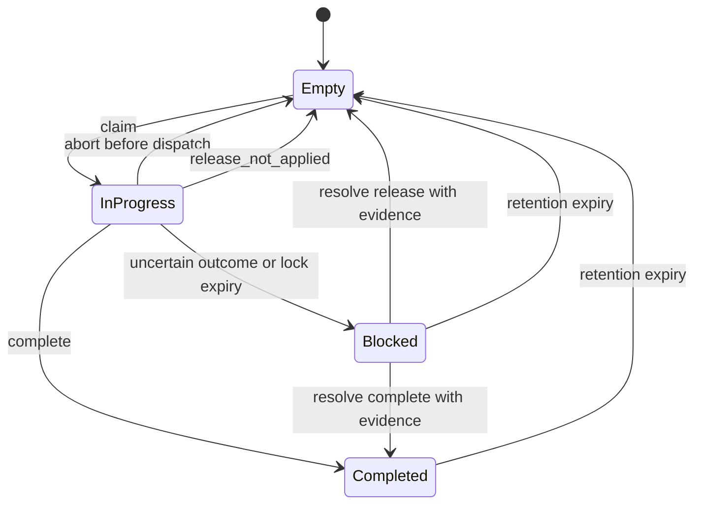

# Marain

Marain is the name of this repository. In Iain M. Banks's Culture novels, Marain is a language built for precise meaning.

## What it does

A coding agent that retries the same patch can send the same HTTP call again. It can also run the same SQL again. Marain stores the first outcome in Redis. The next call inside the same scope returns that outcome.

## The value

The second call does not reach the network when four conditions hold. It also does not reach the database. Python and Rust share one token. Each language can replay a record that the other language wrote. A stale owner cannot complete a newer record, because claim stores a fence. An uncertain timeout stays blocked until `resolve_blocked` receives evidence.

The four conditions are:

- The call goes through `Client.once`, `http_request`, `http::request`, `db_execute`, `db::execute`, or Python `urlopen` after `install_urllib_enforcement`.
- The scope file for this agent and this worktree exists and still matches the execution identity.
- The Redis key `idempotency:v1:<token>` still holds a completed record inside its retention time.
- The stored body is one of the replayable envelopes in [PROTOCOL.md](PROTOCOL.md).

The default retention time is 86400 seconds.

## When to use it

Use Marain when an agent may repeat the same worktree patch. Use it for an HTTP call whose second run would duplicate a side effect. Use it for a database transaction with that same risk. The process must reach Redis. The process must run `agent-idempotency establish` before those calls.

## When the guarantee does not hold

The guarantee does not hold in these cases:

- A bypassed call, or a database driver used directly
- A missing scope, or a stale scope
- A Redis outage. The wrapper does not send the call.
- Lock expiry after dispatch. The record stays blocked.
- Record expiry. The next claim may dispatch again.
- A streaming body. The HTTP wrapper rejects it.
- A result larger than 65536 bytes. The record stays blocked.
- A database session that is already inside a transaction. The wrapper does not claim.

Python `call_unprotected` writes `.idempotency/bypasses.jsonl` before the call. A write error skips the call. Rust `call_unprotected` ignores an audit write error. Rust still runs the call.

`requests`, `httpx`, raw sockets, and a database driver used directly stay outside the guarantee.

## Benefits an integrator can check

- A missing scope, a stale scope, or a Redis outage does not send the call.
- Python can replay a Redis record that Rust wrote.
- Rust can replay a Redis record that Python wrote.
- A stale owner cannot complete a newer record.
- The wrapper stores a known HTTP status and replays it, including 4xx and 5xx.
- The wrapper stores a database rollback as `rolled_back`.
- A 64-character hex `IDEMPOTENCY_RECORD_KEY` encrypts the snapshot and the result with AES-256-GCM.
- The wrapper redacts snapshot keys named like secrets before storage.
- `install-hooks` keeps the previous hook and chains it.

## How an agent uses it

The agent process and the git hook do not share an environment. The scope file is the channel between them. A Rust program and the Python command must come from the same commit of this repository.

1. Install the Python package into the environment that runs the agent and git.
2. Start Redis. Set `IDEMPOTENCY_REDIS_URL`.
3. Set `IDEMPOTENCY_REQUIRE_TLS=1` when the URL uses `rediss://`.
4. Set `IDEMPOTENCY_AGENT_ID` when two agents share one worktree.
5. Add `.idempotency/` to the consumer `.gitignore`.
6. Run `agent-idempotency establish` before any wrapped call.
7. Build a client with `Client.from_env()` in Python, or `Client::from_env()` in Rust.
8. Send HTTP with `http_request` or `http::request`.
9. Run one database transaction with `db_execute` or `db::execute`.
10. Call `resolve_blocked` with evidence for a blocked record.

Only `establish` creates a scope or rotates its id. A later edit makes the scope stale. Later calls then fail closed until establish runs again.

`install_urllib_enforcement` routes Python `urlopen` through the same client. `requests` and `httpx` stay outside the guarantee.

`agent-idempotency install-hooks` is optional. The default hook mode is passive. Passive mode never contacts Redis and never creates a scope. Active mode is `IDEMPOTENCY_HOOK_MODE=active`. Active mode skips a preserved hook only when the stored exit code is 0 and the scope is current.

Git hooks find `agent-idempotency` on `PATH`. If the command is missing, passive mode still runs the preserved hook. Active mode exits 127 and does not run that hook.

Python database support in this tree is `SqliteSession`. A caller may pass another session that honors one transaction boundary.

```python
from agent_idempotency import Client, http_request

client = Client.from_env()
response = http_request(client, "POST", "https://example.test/charge", body=b"{}")
```

The Rust client reads the scope file that `establish` already wrote.

```rust
use agent_idempotency::http;
use agent_idempotency::Client;

let client = Client::from_env()?;
let response = http::request(&client, "POST", "https://example.test/charge", &[], body, &transport)?;
```

`release` deletes a blocked key. `complete` stores a contract body that fits the size limit. No resolver runs on its own.

## Diagrams

The agent establishes a scope, then the SDK claims one Redis key.



A record moves through four states. Expiry deletes the key, and the next claim may dispatch again.



## Configuration

- `IDEMPOTENCY_REDIS_URL` has no default. A claim requires it.
- `IDEMPOTENCY_RECORD_TTL_SECONDS` defaults to `86400`. This is the retention boundary.
- `IDEMPOTENCY_LOCK_TTL_MS` defaults to `120000`. This is the in-progress lock.
- `IDEMPOTENCY_WAIT_MS` defaults to `120000`. This is the waiter bound.
- `IDEMPOTENCY_POLL_MS` defaults to `100`. This is the waiter poll.
- `IDEMPOTENCY_MAX_RESULT_BYTES` defaults to `65536`. This is the contract envelope limit.
- `IDEMPOTENCY_RECORD_KEY` has no default. Set 64 hex characters to encrypt records with AES-256-GCM.
- `IDEMPOTENCY_REQUIRE_TLS` has no default. `1` refuses a URL that does not start with `rediss://`.
- `IDEMPOTENCY_AGENT_ID` defaults to the file `.idempotency/agent-id`.
- `IDEMPOTENCY_SCOPE_FILE` defaults to `.idempotency/scopes/<agent>.json`.
- `IDEMPOTENCY_HOOK_MODE` defaults to `passive`. `active` claims a hook key.

Anyone who can read this Redis prefix can read records. Limit the Redis user to `idempotency:v1:*` and to `GET`, `SET`, `DEL`, `EVAL`, `TIME`, `EXPIRE`, and `INCR`.

The same retention time is the exposure window for data that the record still holds.

## Install

Redis must already be running. This repository does not publish packages to PyPI or crates.io yet.

Install the Python package from git:

```text
pip install "agent-idempotency @ git+https://github.com/boue/marain.git#subdirectory=python"
```

Add the Rust crate from the same git commit. The package lives in the workspace member `rust`.

```toml
agent-idempotency = { git = "https://github.com/boue/marain.git" }
```

## Glossary

- **scope**: the identity of one agent, one worktree, and one patch.
- **token**: the hash of a scope id and one operation id.
- **dispatch**: the wrapper's decision to invoke the external call.
- **blocked**: a record that must not dispatch again until `resolve_blocked` runs with evidence.
- **execution identity**: the hash of worktree bytes compared with the HEAD recorded at establish.

The normative contract is [PROTOCOL.md](PROTOCOL.md).
